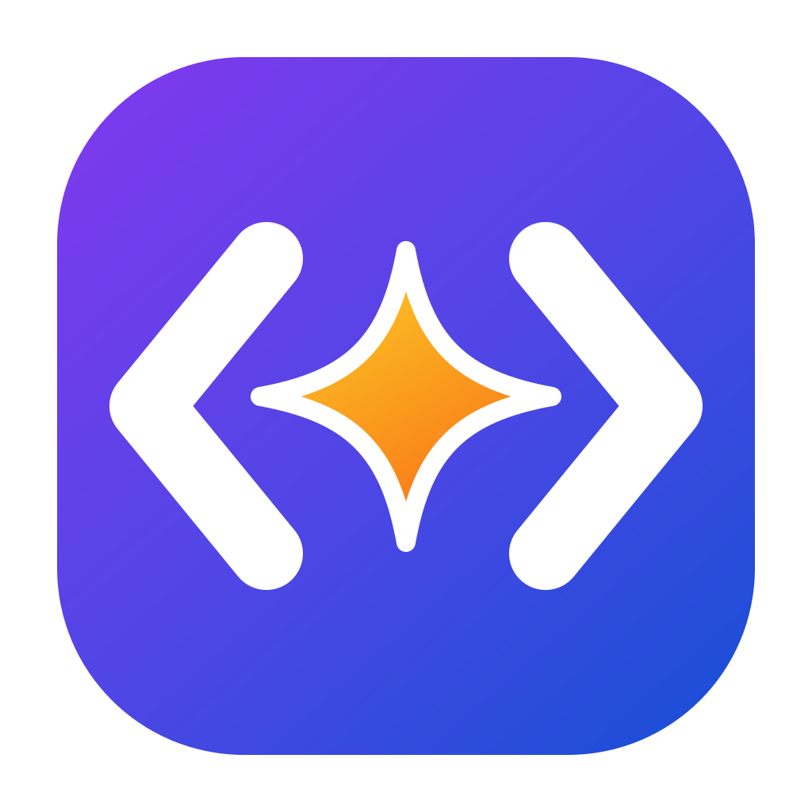
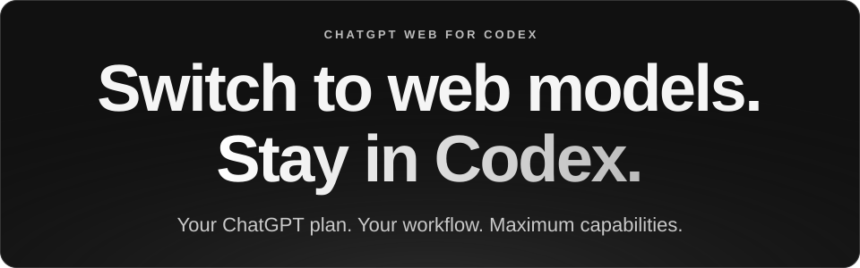
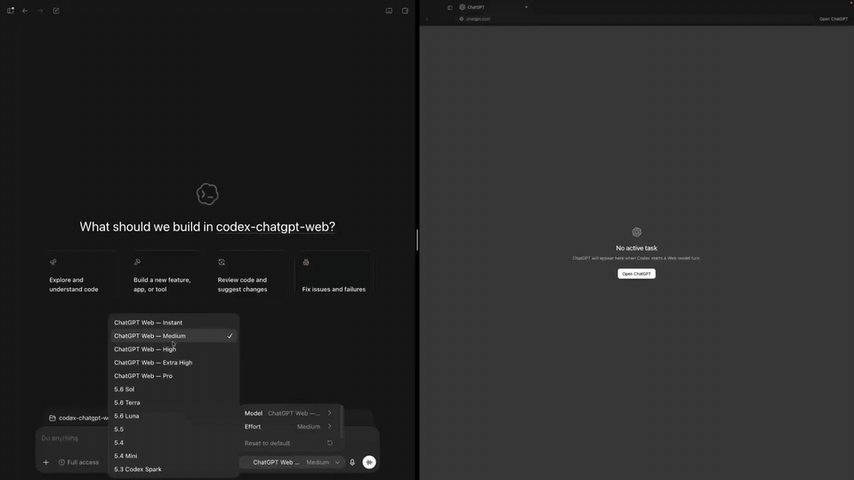

<h1 align="center">GPT Code</h1>

<p align="center">
  
</p>

<p align="center">
  
</p>

<p align="center">
  <a href="https://github.com/zcs2004/GPT-Code/releases/download/v1.6.3/gpt-code-1.6.3-win-x64.exe"></a>&nbsp;
  <a href="https://github.com/zcs2004/GPT-Code/releases/download/v1.6.3/gpt-code-1.6.3-linux-x64.AppImage"></a>&nbsp;
  <a href="https://github.com/zcs2004/GPT-Code/releases/download/v1.6.3/gpt-code-1.6.3-linux-arm64.AppImage"></a>
</p>

<p align="center">
  <a href="https://github.com/zcs2004/GPT-Code/releases/latest">All releases</a> · Current version: <strong>v1.6.3</strong>
</p>

<p align="center">
  <a href="README.md">English</a> · <a href="README.zh-CN.md">简体中文</a> · <a href="README.ja.md">日本語</a> · <a href="README.ko.md">한국어</a>
</p>

<p align="center">
  
</p>

<p align="center">
  <a href="#get-started">Get started</a> · <a href="https://github.com/zcs2004/GPT-Code/releases">What’s new</a> · <a href="docs/architecture.md">Architecture</a> · <a href="TROUBLESHOOTING.md">Troubleshooting</a>
</p>

GPT Code connects to native Codex through its Codex plugin and MCP instead of embedding a second Codex workbench in the launcher. Codex remains responsible for full coding tasks, terminal commands, file changes, and approvals; GPT Code manages ChatGPT Web, models, connectors, MCP servers, and local workspace capabilities.

Full harness mode securely connects ChatGPT tool calls back to the current Codex task through MCP. Usage remains subject to the corresponding account and workspace policies while task context and the native Codex workflow stay intact.

## Project origin and improvements

GPT Code is developed primarily from [miuuyy/codex-chatgpt-web](https://github.com/miuuyy/codex-chatgpt-web). We are grateful to its authors and contributors for the original project. This fork focuses on context-length optimization, a more complete multilingual system, intelligent multipart delivery for oversized Codex input, MCP and Windows runtime reliability, and a product experience tailored to GPT Code. Upstream and third-party components retain their original copyright and license notices.

## What's new in v1.6.3

- Added official GPT Code packages for Windows x64, Linux x64, and Linux ARM64.
- Added GitHub Releases-based update checks, verified downloads, and platform-aware installers.
- Added intelligent multipart delivery for oversized Codex input so long turns no longer depend on
  a fixed six-part split.
- Improved MCP runtime verification, Windows key-file permission handling, browser smoke coverage,
  and multilingual UI coverage.
- Replaced the obsolete task-center navigation with GPT Code support and donation pages.
- Added a reproducible Docker pipeline for verified Linux x64 and ARM64 AppImage builds.

See the complete binaries and checksums in the [v1.6.3 release](https://github.com/zcs2004/GPT-Code/releases/tag/v1.6.3).

<div id="get-started"><a id="quick-start"></a></div>

## Get started

**Available models:** Free/Go → **Luna / Think**. Paid accounts → **GPT-6.2 Sol**, **GPT-6 Sol**, and **GPT-5.6 Sol**, with **Instant–High**, plus **Extra High** and **Pro** when available. Each version has its own entry; existing chats keep their selected version. Availability depends on your account and workspace.

1. **Install GPT Code** using the download for your system above.
2. **Sign in to ChatGPT** in GPT Code's embedded browser and run the browser smoke test.
3. **Install the Codex plugin** from setup, then restart Codex.
4. **Connect MCP** under GPT Code's **MCP** page. Continue complete coding work in native Codex after the harness is ready.

The app includes its browser and runtime. No separate Chrome, Node, or Bun installation is needed.

<details>
<summary><strong>Terminal install, updates & repair</strong></summary>

Quit the launcher before updating. These installers select the platform and architecture, verify the published checksums, and preserve your ChatGPT profile and launcher settings.

**Linux**

```bash
curl -fsSL https://github.com/zcs2004/GPT-Code/releases/latest/download/install-launcher.sh | sh
```

**Windows PowerShell**

```powershell
irm https://github.com/zcs2004/GPT-Code/releases/latest/download/install-launcher.ps1 | iex
```

</details>

<details>
<summary><strong>Models, modes & MCP setup</strong></summary>

<a id="modes"></a>

Automatic modes offer Luna/Think when the account has no reasoning selector; otherwise Instant–High, with Extra High and Pro available independently when exposed by the account.

| Mode | Sending messages | Local Codex tools |
| --- | --- | --- |
| **Browser-only** | Automatic | No |
| **Full harness (With Automation)** | Automatic | Yes, through MCP |
| **Zero Risk** | Paste and send manually | Yes, through a separate MCP connector |

Zero Risk does not read or operate the ChatGPT page. Choose the model and `Codex Zero Risk` connector yourself, paste and send the prepared prompt, then confirm **Sent** in the launcher. Automatic models ending in **(Web)** expose their supported Effort choices in Codex. Instant and each Pro version have separate entries to preserve their context budgets; older saved model entries keep their original fixed mode.

<a id="full-harness"></a>

### Full harness

Full mode connects ChatGPT's tool calls back to the current Codex task through the official
[OpenAI tunnel-client](https://github.com/openai/tunnel-client). The tunnel is outbound: it does
not expose a public IP, open an inbound port, or require router forwarding.

The launcher uses your system proxy for the tunnel. Explicitly configured proxy
environment variables take priority; local connections stay local.

The launcher's **MCP** page guides the complete setup. For the exact clicks, see the
[video walkthroughs](TROUBLESHOOTING.md).

> **Limits**
>
> See [Limits](https://github.com/miuuyy/codex-chatgpt-web/discussions/309) for the current
> ChatGPT message allowances for **GPT-5.6 Sol Pro** and **GPT-6 Astra**. Context limits depend on
> the account type and selected effort. Plus Medium/High uses a measured 90,000-token window.
> GPT-5.6 supports up to 270,000 tokens with experimental **3× context** enabled, with native
> Codex compaction supported throughout.
>
> GPT-6 Sol supports Bigger Context at Medium, High and available Extra High: **120,000 tokens
> on Plus**, with compaction at **110,000**, and **240,000 on Pro**, with compaction at **220,000**.
> GPT-6 Instant uses standard context.
> GPT-5.6 and GPT-6 Pro keep their existing Bigger Context limits.

1. Finish the required setup, open **MCP**, create the Tunnel and regular API key, then press
   **Connect harness**.
2. Enable ChatGPT **Developer Mode** and create a new Tunnel connector named exactly
   **Codex Native2**, with **Authentication: None** and **Allow all actions**.
3. Run **Verify runtime** to confirm that **Codex Native2** is attached and available.

Write/modify actions also require the ChatGPT workspace and its administrator policy to permit
them. See
[developer mode and MCP apps](https://help.openai.com/en/articles/12584461-developer-mode-and-mcp-apps-in-chatgpt).
Unexpected approval prompts fail closed unless `--auto-approve-tool-calls` is explicitly enabled;
that option clicks **Allow once**, never a permanent grant.

</details>

<details>
<summary><strong>Diagnostics & subagents</strong></summary>

<a id="operations"></a>

Use **Activity** for safe local diagnostics and **Settings → Run doctor** for end-to-end health.
Settings can also cancel a retained browser turn or remove the Codex integration before uninstall.
**Settings → Temporary Chat** is on by default and keeps new task conversations out of ChatGPT
history. Turn it off to use ordinary saved chats or if your connector is unavailable in that mode.
ChatGPT memory and custom instructions may apply in either mode. **New browser chat for each turn**
separately controls conversation reuse. An explicit choice to disable Temporary Chat is preserved when updating.
Set `CODEX_CHATGPT_WEB_BROWSER_DIAGNOSTICS=1` only when every browser checkpoint needs a screenshot.

New installs use **Compatibility V1** for cross-backend subagents. **Native** preserves Codex's own
feature settings and enables plaintext Web-to-Web V2 delegation. Restart Codex and start a new task
after changing the protocol:

```bash
codex-chatgpt-web subagents status
codex-chatgpt-web subagents compatibility-v1
codex-chatgpt-web subagents native
```

</details>

<details>
<summary><strong>Requirements & security</strong></summary>

<a id="limitations-and-security"></a>

- This is unofficial browser automation, not an OpenAI API. ChatGPT UI changes can break selectors;
  drift fails explicitly instead of silently switching model or transport.
- Browser state is a sensitive login artifact, and the loopback listener is reachable by processes
  running as the same local user. Never share the launcher profile; use a trusted workstation.
- Release packages target Windows x64 and Linux x64/arm64. macOS remains in source-level CI only and
  is not included in published releases. Account-bound browser and MCP flows use the separate
  [release validation](docs/release-validation.md).
- Formal Windows releases require Authenticode signing. Linux installers and every updater verify
  the published SHA-256 manifest before installation; local development builds may remain unsigned.

Read the complete [architecture](docs/architecture.md) and
[security model](docs/security-model.md) before enabling full mode. Report vulnerabilities through
[SECURITY.md](SECURITY.md).

Task prompts are processed by OpenAI and conversations remain in your ChatGPT history.

Validation coverage: [release validation](docs/release-validation.md).

This is independent software and is not affiliated with or endorsed by OpenAI. Use it only with
your own account and in accordance with applicable [Terms of Use](https://openai.com/policies/terms-of-use/)
and workspace policies; it does not bypass authentication or access controls.

</details>

<details>
<summary><strong>Run from source & develop</strong></summary>

<a id="development"></a>

```bash
git clone https://github.com/zcs2004/GPT-Code.git && \
cd GPT-Code && \
bun run app
```

This source path requires Bun 1.4.0. The command installs locked dependencies and opens the app.

```bash
bun run app
bun run dev:launcher
bun run src/cli.ts dev status
bun run dev:chat compaction-lab "Reply with exactly: DEV READY"
bun run verify
bun run smoke:subagents
bun run app:package
```

`dev:launcher` uses a separate profile and account under `~/.codex-chatgpt-web-dev`. `dev:chat` exercises the real browser and compaction paths with explicit simulated tool results, without changing your normal Codex route. See the [DEV chat harness](docs/dev-chat.md) for setup and commands.

</details>

## Repository

Source code, releases, and issue tracking are available at [zcs2004/GPT-Code](https://github.com/zcs2004/GPT-Code). You can also visit the author's [personal website](https://per.dhuzcs.com/).

GPT Code is owned and maintained by [zcs2004](https://github.com/zcs2004). See
[CONTRIBUTORS.md](CONTRIBUTORS.md) for the current project-maintainer record and upstream
acknowledgements. Contributions should follow the GPT Code-specific
[contribution guide](CONTRIBUTING.md).

---

[Troubleshooting](TROUBLESHOOTING.md) · [Security](SECURITY.md) · [Contributing](CONTRIBUTING.md) · [Contributors](CONTRIBUTORS.md) · [Apache License 2.0](LICENSE) · [CI](https://github.com/zcs2004/GPT-Code/actions/workflows/ci.yml)
