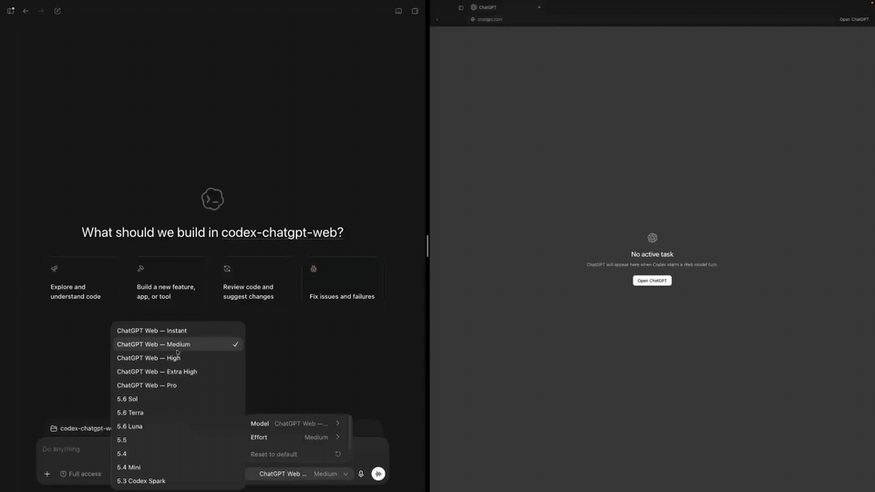

<h1 align="center">GPT Code</h1>

<p align="center">
  
</p>

<p align="center">
  
</p>

<p align="center">
  <a href="https://github.com/zcs2004/GPT-Code/releases/download/v1.6.3/gpt-code-1.6.3-win-x64.exe"></a>&nbsp;
  <a href="https://github.com/zcs2004/GPT-Code/releases/download/v1.6.3/gpt-code-1.6.3-linux-x64.AppImage"></a>&nbsp;
  <a href="https://github.com/zcs2004/GPT-Code/releases/download/v1.6.3/gpt-code-1.6.3-linux-arm64.AppImage"></a>
</p>

<p align="center">
  <a href="https://github.com/zcs2004/GPT-Code/releases/latest">所有版本</a> · 当前版本：<strong>v1.6.3</strong>
</p>

<p align="center">
  <a href="README.md">English</a> · <a href="README.zh-CN.md">简体中文</a> · <a href="README.ja.md">日本語</a> · <a href="README.ko.md">한국어</a>
</p>

<p align="center">
  
</p>

<p align="center">
  <a href="#get-started">开始使用</a> · <a href="https://github.com/zcs2004/GPT-Code/releases">更新内容</a> · <a href="docs/architecture.md">架构</a> · <a href="TROUBLESHOOTING.md">故障排除</a>
</p>

GPT Code 通过 Codex 插件与 MCP 连接原生 Codex，不在启动器中重复嵌入另一套 Codex 工作台。Codex 继续负责完整的编程任务、终端、文件修改与审批流程；GPT Code 负责 ChatGPT Web、模型、连接器、MCP 服务和本地工作空间能力。

完整 harness 模式通过 MCP 将 ChatGPT 的工具调用安全地连接回当前 Codex 任务。消息受对应账户及工作区的使用限制约束，任务上下文和原生 Codex 操作体验保持不变。

## 项目来源与改进方向

GPT Code 主要基于 [miuuyy/codex-chatgpt-web](https://github.com/miuuyy/codex-chatgpt-web) 继续开发，感谢原项目作者和贡献者提供的基础。当前分支重点进行了上下文长度优化、语言体系补充、Codex 超大输入智能分批发送、MCP 与 Windows 运行时可靠性改进，以及面向 GPT Code 的独立产品体验调整。上游和第三方组件继续保留其原有版权与许可证声明。

## v1.6.3 更新内容

- 提供 Windows x64、Linux x64 与 Linux ARM64 三套 GPT Code 正式下载包。
- 增加基于 GitHub Releases 的更新检测、下载校验与平台识别安装流程。
- 为超大 Codex 输入增加智能分批发送，不再依赖固定的最多六段拆分。
- 改进 MCP 运行时验证、Windows 密钥文件权限处理、浏览器冒烟测试和多语言覆盖。
- 移除已无实际用途的任务中心入口，增加 GPT Code 技术支持与捐款页面。
- 增加可复现的 Docker Linux x64/ARM64 AppImage 打包流水线。

完整安装包与校验值请查看 [v1.6.3 Release](https://github.com/zcs2004/GPT-Code/releases/tag/v1.6.3)。

<div id="get-started"><a id="quick-start"></a></div>

## 开始使用

**可用模型：** Free/Go → **Luna / Think**；具有推理控制选项的账户 → **Instant–High**，并按实际可用状态提供 **Extra High** 和 **Pro**。启动器会自动检测账户可用的模型。

1. **安装 GPT Code**：点击上方对应系统的下载按钮。
2. **登录 ChatGPT**：在 GPT Code 的内置浏览器中登录，并运行浏览器冒烟测试。
3. **安装 Codex 插件**：按照设置页完成模型与插件安装，然后重启 Codex。
4. **连接 MCP**：在 GPT Code 的 **MCP** 页面完成完整 harness 配置；之后直接在原生 Codex 中工作。

应用已包含浏览器和运行时，无需另外安装 Chrome、Node 或 Bun。

<details>
<summary><strong>命令行安装、更新与修复</strong></summary>

更新前请退出启动器。以下安装脚本会选择正确的平台和架构、验证发布的校验和，并保留 ChatGPT 配置文件和启动器设置。

**Linux**

```bash
curl -fsSL https://github.com/zcs2004/GPT-Code/releases/latest/download/install-launcher.sh | sh
```

**Windows PowerShell**

```powershell
irm https://github.com/zcs2004/GPT-Code/releases/latest/download/install-launcher.ps1 | iex
```

</details>

<details>
<summary><strong>模型、模式与 MCP 设置</strong></summary>

<a id="modes"></a>

自动模式在账户没有推理选择器时提供 Luna/Think；否则提供 Instant–High，并分别按账户实际可用状态显示 Extra High 和 Pro。

| 模式 | 发送消息 | 本地 Codex 工具 |
| --- | --- | --- |
| **Browser-only** | 自动 | 不支持 |
| **Full harness (With Automation)** | 自动 | 支持，通过 MCP |
| **Zero Risk** | 手动粘贴并发送 | 支持，通过独立 MCP 连接器 |

Zero Risk 不读取或操作 ChatGPT 页面。请自行选择模型和 `Codex Zero Risk` 连接器，粘贴并发送准备好的提示词，再在启动器中确认 **Sent**。名称以 **(Web)** 结尾的自动模型会在 Codex 中提供其支持的 Effort 选项。Instant 和各个 Pro 版本使用独立条目，以保留各自的上下文额度；旧任务中保存的模型条目仍使用原来的固定模式。

<a id="full-harness"></a>

### 完整 harness

完整模式通过官方
[OpenAI tunnel-client](https://github.com/openai/tunnel-client)
将 ChatGPT 的工具调用连接回当前 Codex 任务。该隧道为出站连接：不会暴露公网 IP、开放入站端口，
也不需要配置路由器端口转发。

> **限制**
>
> 有关 **GPT-5.6 Sol Pro** 和 **GPT-6 Astra** 当前的 ChatGPT 消息额度，请参阅
> [Limits](https://github.com/miuuyy/codex-chatgpt-web/discussions/309)。Token 上下文上限取决于
> 账户类型和所选 effort。Plus 的 Medium/High 使用实测的 90,000-token 窗口；启用实验性的
> **3× context** 后最高为 270,000 tokens，并且全程支持原生 Codex compaction。

1. 完成启动器中的必需设置。
2. 在启动器中打开 **MCP**。请在将使用 ChatGPT 连接器的同一个 OpenAI 账户中创建 Tunnel
   和普通 API 密钥；创建密钥本身免费，也不会消耗模型 API 额度。
3. 粘贴 Tunnel ID 和 API 密钥，然后点击 **连接 Harness**。
4. 在 ChatGPT 设置中启用 **开发者模式**。新建连接器时选择 **Tunnel**，选择刚创建的
   Tunnel，将 **身份验证** 设为 **无**，并将名称准确设置为 **Codex Native2**。
5. 在 **Codex Native2** 的 **权限** 中选择 **允许所有操作**；**允许低风险操作** 会在命令和
   补丁到达本地运行时前将其拦截。外层 Codex harness 仍会执行沙箱和审批规则。
6. 运行 **验证运行时**，确认 **Codex Native2** 已连接并可用。

写入/修改操作还需要 ChatGPT 工作区及其管理员政策允许。请参阅
[开发者模式和 MCP 应用](https://help.openai.com/en/articles/12584461-developer-mode-and-mcp-apps-in-chatgpt)。
除非显式启用 `--auto-approve-tool-calls`，否则意外的审批提示会直接失败；该选项只会点击
**Allow once**，绝不会授予永久权限。

</details>

<details>
<summary><strong>诊断与子代理</strong></summary>

<a id="operations"></a>

使用 **活动** 页面查看安全的本地诊断，并通过 **设置 → 运行诊断** 执行端到端健康检查。设置页还可
取消保留的浏览器任务，或在卸载前移除 Codex 集成。仅在需要为每个浏览器检查点保存截图时设置
`CODEX_CHATGPT_WEB_BROWSER_DIAGNOSTICS=1`。

新安装默认使用 **Compatibility V1** 以支持跨后端 subagent。**Native** 会保留 Codex 自身的
功能设置，并启用明文 Web-to-Web V2 委派。切换协议后，请重启 Codex 并创建新任务：

```bash
codex-chatgpt-web subagents status
codex-chatgpt-web subagents compatibility-v1
codex-chatgpt-web subagents native
```

</details>

<details>
<summary><strong>系统要求与安全</strong></summary>

<a id="limitations-and-security"></a>

- 这是非官方浏览器自动化，并非 OpenAI API。ChatGPT UI 变更可能破坏选择器；发生变化时会明确
  失败，而不是静默切换模型或传输方式。
- 浏览器状态是敏感的登录凭据，loopback 监听器也可被同一本地用户运行的进程访问。切勿共享
  启动器 profile，并仅在可信工作站上使用。
- 正式发布包仅面向 Windows x64 与 Linux x64/arm64。macOS 只保留源码级 CI 兼容检查，不进入
  GitHub Release。依赖账户的浏览器与 MCP 流程使用单独的[发布验证](docs/release-validation.md)。
- 正式 Windows 版本必须通过 Authenticode 签名；Linux 安装器和各平台更新器会在安装前验证已发布的
  SHA-256 清单。本地开发构建仍可能是未签名版本。

启用完整模式前，请阅读完整的[架构说明](docs/architecture.md)和
[安全模型](docs/security-model.md)。安全漏洞请通过 [SECURITY.md](SECURITY.md) 报告。

任务默认使用“临时聊天”，不会保留在 ChatGPT 历史记录中。可在设置中关闭此选项以使用普通聊天；如果连接器不可用，也请关闭此选项。提示词仍由 OpenAI 处理。

验证范围：[发布验证](docs/release-validation.md)。

本项目是独立软件，与 OpenAI 无关联，也未获得 OpenAI 背书。请仅使用自己的账户，并遵守适用的
[使用条款](https://openai.com/policies/terms-of-use/)和工作区政策；本项目不会绕过身份验证或
访问控制。

</details>

<details>
<summary><strong>从源码运行与开发</strong></summary>

<a id="development"></a>

```bash
git clone https://github.com/zcs2004/GPT-Code.git && \
cd GPT-Code && \
bun run app
```

源码方式需要 Bun 1.4.0。该命令会安装锁定版本的依赖并打开应用。

```bash
bun run app
bun run dev:launcher
bun run src/cli.ts dev status
bun run dev:chat compaction-lab "Reply with exactly: DEV READY"
bun run verify
bun run smoke:subagents
bun run app:package
```

`dev:launcher` 在 `~/.codex-chatgpt-web-dev` 下使用独立配置和账户。`dev:chat` 使用真实浏览器与压缩流程，并提供明确的模拟工具结果，不改变正常 Codex 路由。设置和命令请参阅 [DEV chat harness](docs/dev-chat.md)。

</details>

## 项目仓库

源代码、版本发布和问题跟踪位于 [zcs2004/GPT-Code](https://github.com/zcs2004/GPT-Code)。也可以访问作者的[个人网站](https://per.dhuzcs.com/)。

GPT Code 由 [zcs2004](https://github.com/zcs2004) 拥有并维护。

---

[故障排除](TROUBLESHOOTING.md) · [安全](SECURITY.md) · [参与贡献](CONTRIBUTING.md) · [贡献者](CONTRIBUTORS.md) · [Apache License 2.0](LICENSE) · [CI](https://github.com/zcs2004/GPT-Code/actions/workflows/ci.yml)
