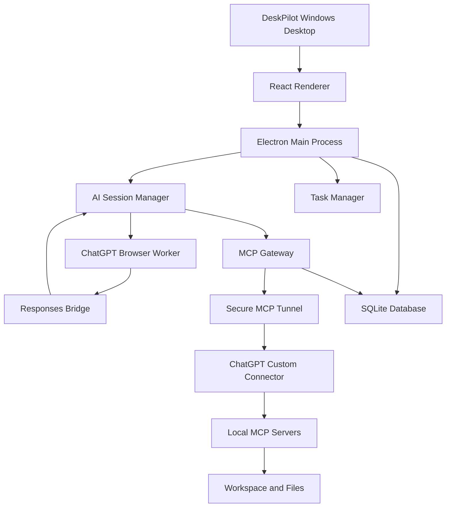
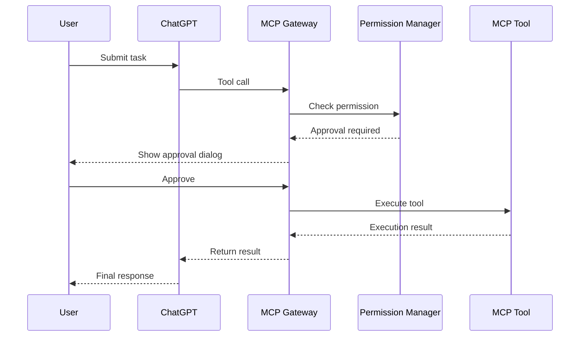

产品需求与技术开发设计文档
文档版本： V0.1.0
项目状态： 方案设计阶段
目标平台： Windows 10/11 x64
部署模式： 本机单用户
开发模式： Fork 二次开发
基础项目： miuuyy/codex-chatgpt-web
________________________________________
1. 项目概述
1.1 项目背景
GPT Code 是一个基于 Windows 的个人 AI 工作平台。
项目通过复用 codex-chatgpt-web 的 ChatGPT Web 会话桥接能力，使用户可以在自己的 Windows 桌面应用中使用已登录的 ChatGPT 账户，并通过 MCP（Model Context Protocol）连接本地计算机和外部工具。
项目不以开发一个简单的 ChatGPT 聊天客户端为目标，而是构建一个具备工具调用、工作空间管理、任务执行和扩展能力的个人 AI 工作环境。
1.2 项目目标
主要目标：
1.	将 ChatGPT Web 能力集成到独立的 Windows 桌面应用。
2.	复用已有 ChatGPT 登录会话，不默认依赖 OpenAI 模型 API Key。
3.	通过 MCP 实现 AI 与本地工具之间的交互。
4.	提供统一的文件、程序、浏览器及办公工具管理界面。
5.	支持 AI 执行多步骤任务。
6.	支持任务过程跟踪、权限审批和执行记录。
7.	形成可扩展的 MCP 工具生态。
1.3 产品定位
GPT Code 定位为：
以 ChatGPT 为 AI 核心，以 MCP 为工具连接协议，以 Windows 为执行环境的个人 AI 工作平台。
1.4 设计原则
•	Local First：优先本地运行。
•	Modular：功能模块化。
•	Extensible：支持扩展 MCP Server。
•	Secure by Default：默认安全。
•	Reusable：尽可能复用上游项目成熟能力。
•	Maintainable：减少对上游核心代码的侵入。
________________________________________
2. 项目范围
2.1 第一阶段功能
第一版必须实现：
模块	功能
AI 对话	ChatGPT Web 会话、连续对话、流式输出
会话管理	新建会话、历史会话、上下文管理
MCP 管理	MCP Server 添加、删除、连接、断开
工具管理	工具发现、调用、执行状态
工作空间	本地项目目录管理
文件操作	文件读取、创建、修改
任务中心	任务创建、执行、取消、结果查看
权限系统	工具授权、操作审批
系统设置	ChatGPT 登录、网络、运行环境配置
诊断系统	服务状态、错误日志、运行检测
2.2 后续扩展功能
•	PowerShell 自动化。
•	Git 项目管理。
•	浏览器自动化。
•	Word、Excel、PowerPoint 文件处理。
•	SQLite、MySQL、PostgreSQL 数据库连接。
•	图片理解和附件处理。
•	定时任务。
•	自定义 AI 工作流程。
•	多 MCP Server 协同。
•	本地知识库和检索。
2.3 第一版不包含
•	多用户账户体系。
•	云端服务器部署。
•	公网访问。
•	自建模型推理服务。
•	自主执行不可逆的高风险操作。
•	绕过 ChatGPT 账户使用限制。
________________________________________
3. 技术架构
3.1 总体架构
采用 Electron + React + TypeScript + Bun。
原项目的 Electron Launcher、ChatGPT Browser Worker、Responses Bridge、MCP Broker 和 Tunnel 能力优先复用。
在其基础上新增 DeskPilot 的工作空间、任务管理、通用工具权限和应用界面。

说明：
•	Electron：负责 Windows 桌面应用生命周期。
•	React：负责桌面应用界面。
•	Bun：运行本地服务和 TypeScript 业务代码。
•	Browser Worker：管理 ChatGPT 登录会话及网页交互。
•	Responses Bridge：负责请求转换和流式响应。
•	MCP Gateway：负责工具发现、权限控制和调用分发。
•	Secure MCP Tunnel：将本地 MCP 能力安全地连接到 ChatGPT。
•	SQLite：保存应用配置、对话索引、任务和日志。
3.2 技术选型
技术	用途
Electron	Windows 桌面运行环境
React 19	UI
TypeScript	主开发语言
Vite	前端构建
Bun 1.4.0	JavaScript/TypeScript 运行时
Playwright	浏览器自动化相关能力
MCP SDK	MCP 协议实现
SQLite	本地数据存储
SSE	流式事件传输
electron-builder	Windows 安装包
版本以实际 Fork 的上游锁定依赖为基准，升级时需要重新进行兼容性验证。
________________________________________
4. 上游项目改造策略
4.1 改造原则
采用 Fork 方式开发。
不直接重写上游 ChatGPT Web 接入层，不在初期修改不必要的底层浏览器机制。
优先通过新增模块、接口适配和配置解耦实现产品化。
4.2 模块改造表
上游模块	改造策略
Electron Launcher	保留，重新设计产品界面
ChatGPT Browser Worker	保留
Responses Bridge	保留，解耦 Codex 专属接口
Streaming	保留
MCP Tunnel	保留
MCP Broker	改造成通用工具网关
MCP Server	保留协议基础，扩展工具管理
Codex Context	替换为 DeskPilot Context
Codex Workspace	改造成通用工作空间
Codex Permissions	替换为 DeskPilot 权限系统
Codex Task Lifecycle	改造成通用任务生命周期
Codex Integration	移除不需要的 Codex 专属集成
4.3 代码改造约束
1.	上游核心代码与 DeskPilot 新增代码尽量分离。
2.	不随意修改 ChatGPT DOM 选择器。
3.	不破坏上游浏览器会话管理。
4.	不删除上游必要的诊断和健康检查机制。
5.	不将 ChatGPT 网页自动化误认为官方 API。
6.	对上游更新建立定期合并和回归测试机制。
________________________________________
5. 功能模块设计
5.1 AI 对话模块
功能：
•	新建对话。
•	连续多轮对话。
•	流式输出。
•	Markdown 渲染。
•	代码块展示。
•	图片和文件附件。
•	会话中断。
•	会话历史。
•	模型和推理模式展示。
对话生命周期：
1.	用户创建对话。
2.	系统初始化 ChatGPT 会话。
3.	用户发送消息。
4.	Browser Worker 将请求提交给 ChatGPT。
5.	系统接收并解析响应。
6.	如果存在工具调用，进入 MCP 执行流程。
7.	接收工具结果并继续处理。
8.	返回最终回答。
必须明确区分：
•	正在生成。
•	等待工具执行。
•	等待用户审批。
•	执行失败。
•	已完成。
•	已取消。
5.2 MCP 管理模块
提供独立的 MCP 管理界面。
功能：
•	添加 MCP Server。
•	编辑服务器配置。
•	删除服务器。
•	启动和停止。
•	连接测试。
•	查看工具列表。
•	查看工具参数 Schema。
•	启用和禁用工具。
•	查看调用日志。
建议支持：
•	stdio 本地 MCP。
•	Streamable HTTP MCP。
•	上游项目已有的 Secure MCP Tunnel 机制。
MCP Server 配置示例：
{
  "name": "local-files",
  "transport": "stdio",
  "command": "node",
  "args": [
    "server.js"
  ],
  "enabled": true
}
该配置仅作为 DeskPilot 配置设计示例，实际参数以对应 MCP Server 的文档为准。
5.3 MCP Gateway
MCP Gateway 是整个系统的重要组成部分。
主要职责：
1.	管理 MCP Server。
2.	汇总可用工具。
3.	校验工具参数。
4.	检查用户授权。
5.	执行审批流程。
6.	转发工具调用。
7.	获取工具执行结果。
8.	将结果返回 ChatGPT。
9.	记录执行日志。
工具调用流程：

必须保证工具调用结果与当前任务、当前会话绑定，不能跨任务混用工具权限。
5.4 工作空间模块
工作空间用于管理用户的日常工作目录。
功能：
•	创建工作空间。
•	添加现有目录。
•	删除工作空间关联。
•	查看目录树。
•	文件预览。
•	文件搜索。
•	文件编辑。
•	文件变更记录。
•	工作空间与任务关联。
第一版限制：
只允许访问用户明确授权的目录。
文件删除和覆盖操作需要用户确认。
5.5 任务中心
任务中心负责管理 AI 多步骤任务。
任务状态：
状态	含义
Pending	等待执行
Running	正在执行
WaitingApproval	等待用户审批
WaitingTool	等待工具结果
Completed	执行完成
Failed	执行失败
Cancelled	用户取消
每个任务应包含：
•	Task ID。
•	Conversation ID。
•	创建时间。
•	工作空间。
•	执行步骤。
•	工具调用记录。
•	审批记录。
•	最终结果。
•	错误信息。
任务中心必须支持主动取消，并确保取消后能够清理相关运行资源。
5.6 权限管理模块
权限采用分级管理。
等级	操作	默认策略
L0	查询、只读	授权后自动执行
L1	新建普通文件	需要授权
L2	修改、覆盖文件	每次确认
L3	删除文件	每次确认
L4	PowerShell、CMD	每次确认
L5	发送邮件、外部发布等	每次确认
权限由本地 Gateway 强制执行，而不是只依赖 ChatGPT 的提示词。
即使模型要求执行某项操作，Gateway 也必须先进行权限检查。
________________________________________
6. 本地服务与接口设计
6.1 服务组成
建议将本地运行环境拆分为：
•	Desktop Process：桌面主进程。
•	Core Daemon：业务服务。
•	Browser Worker：浏览器会话。
•	MCP Gateway：工具管理和执行。
•	Task Manager：任务管理。
•	Data Store：数据存储。
6.2 内部 API 设计
以下为 DeskPilot 新增内部接口的建议，不代表上游已有接口。
方法	路径	功能
GET	/health	健康检查
POST	/v1/chat/responses	对话请求
GET	/v1/tasks	查询任务
POST	/v1/tasks	创建任务
POST	/v1/tasks/{id}/cancel	取消任务
GET	/v1/tasks/{id}/events	任务事件流
GET	/v1/mcp/servers	查询 MCP Server
POST	/v1/mcp/servers	添加 MCP Server
GET	/v1/mcp/tools	查询工具
POST	/v1/mcp/tools/{name}/call	调用工具
POST	/v1/approvals/{id}/decision	提交审批
接口采用本机 IPC 或 Loopback HTTP。
所有管理接口必须经过身份校验。
6.3 流式事件
建议统一事件格式：
{
  "event": "tool.started",
  "taskId": "task-001",
  "timestamp": "2026-11-24T08:00:00Z",
  "data": {
    "tool": "read_file"
  }
}
事件类型包括：
•	message.started
•	message.delta
•	message.completed
•	task.started
•	task.progress
•	tool.started
•	tool.completed
•	tool.failed
•	approval.required
•	task.completed
•	task.failed
•	task.cancelled
________________________________________
7. 数据库设计
采用 SQLite。
7.1 数据表
conversations
字段	类型	说明
id	TEXT	主键
title	TEXT	对话标题
created_at	TEXT	创建时间
updated_at	TEXT	更新时间
tasks
字段	类型	说明
id	TEXT	主键
conversation_id	TEXT	对话 ID
workspace_id	TEXT	工作空间 ID
status	TEXT	状态
description	TEXT	任务描述
created_at	TEXT	创建时间
completed_at	TEXT	完成时间
mcp_servers
字段	类型	说明
id	TEXT	主键
name	TEXT	名称
transport	TEXT	传输方式
config	TEXT	配置
enabled	INTEGER	是否启用
tool_permissions
字段	类型	说明
id	TEXT	主键
tool_name	TEXT	工具名称
permission_level	INTEGER	权限等级
approval_required	INTEGER	是否需要审批
approvals
字段	类型	说明
id	TEXT	主键
task_id	TEXT	任务 ID
tool_name	TEXT	工具名称
arguments_hash	TEXT	参数摘要
status	TEXT	审批状态
created_at	TEXT	创建时间
activity_logs
字段	类型	说明
id	TEXT	主键
task_id	TEXT	任务 ID
event_type	TEXT	事件类型
details	TEXT	事件信息
created_at	TEXT	创建时间
日志不得保存 ChatGPT 登录凭据、Tunnel 密钥或不必要的敏感内容。
________________________________________
8. Windows 安全设计
安全是第一版的强制要求。
8.1 登录会话
•	使用独立 Electron 持久化浏览器分区。
•	不导入其他浏览器的 Cookie。
•	不将登录数据写入 Git。
•	不同步到公共云盘。
•	不允许其他应用随意读取浏览器配置文件。
•	提供安全退出和会话注销。
8.2 Tunnel 凭据
原项目的 Tunnel 机制需要相应的 Tunnel 凭据。
因此：
•	不使用模型推理 API Key 作为默认接入方式。
•	Tunnel 所需的认证凭据单独管理。
•	尽量使用 Windows Credential Manager 或 DPAPI 保护敏感凭据。
•	禁止在命令行参数和普通日志中输出密钥。
•	提供凭据轮换和清除功能。
8.3 本地网络
•	服务默认监听 127.0.0.1。
•	不开放公网监听端口。
•	不要求路由器端口转发。
•	管理接口使用随机认证令牌。
•	校验 Origin 和请求来源。
•	防止浏览器页面通过跨站请求访问本地管理接口。
需要注意：Loopback 只能减少网络暴露，不能防御同一 Windows 用户下已经运行的恶意进程。
8.4 MCP 安全
•	工具参数必须经过 Schema 校验。
•	工具执行前进行权限判断。
•	高风险操作需要用户确认。
•	审批必须绑定具体工具及参数摘要。
•	审批后如果参数变化，必须重新审批。
•	禁止模型自行扩大工具权限。
•	工具输出视为不可信数据。
8.5 失败策略
当 ChatGPT 页面结构发生变化时：
•	明确报告页面兼容性错误。
•	不静默切换其他模型。
•	不伪造执行成功。
•	不通过重试绕过账户使用限制。
•	保留诊断信息，等待用户处理。
________________________________________
9. 用户界面设计
9.1 主界面布局
采用三栏式工作台。
左侧导航：
•	首页
•	AI 对话
•	工作空间
•	任务中心
•	MCP 工具
•	历史记录
•	系统设置
中间工作区：
•	当前会话。
•	消息列表。
•	文件附件。
•	任务执行过程。
•	工具调用结果。
右侧面板：
•	当前工作空间。
•	可用 MCP 工具。
•	任务状态。
•	文件信息。
•	审批请求。
底部：
•	消息输入框。
•	附件按钮。
•	模型选择。
•	推理模式。
•	发送按钮。
9.2 界面设计原则
•	使用 Windows 11 风格。
•	支持深色和浅色主题。
•	支持中文。
•	支持窗口缩放。
•	任务运行期间提供明确状态。
•	工具执行过程可查看。
•	发生审批请求时提供清晰提示。
•	保持简洁，不让 MCP 技术细节干扰普通用户。
________________________________________
10. 开发目录规划
以下是建议的新增模块结构，具体位置需要在首次源码审计后与上游目录合并。
deskpilot-ai/
│
├── launcher/
│   ├── electron/
│   ├── src/
│   │   ├── components/
│   │   ├── pages/
│   │   ├── layouts/
│   │   ├── hooks/
│   │   └── services/
│   │
│   └── package.json
│
├── src/
│   ├── browser/
│   ├── responses/
│   ├── tunnel/
│   ├── mcp/
│   │   ├── gateway/
│   │   ├── broker/
│   │   ├── registry/
│   │   └── permissions/
│   │
│   ├── agent/
│   │   ├── session/
│   │   ├── context/
│   │   └── planner/
│   │
│   ├── workspace/
│   ├── tasks/
│   ├── storage/
│   ├── security/
│   └── cli.ts
│
├── tests/
│
├── docs/
│   ├── PRD.md
│   ├── ARCHITECTURE.md
│   ├── MCP_DESIGN.md
│   ├── SECURITY.md
│   ├── DATABASE.md
│   └── DEVELOPMENT_PLAN.md
│
└── README.md
注意：这是目标组织结构，不要求在第一天就重构上游所有文件。应先保留原有结构，再逐步迁移。
________________________________________
11. 开发阶段规划
阶段一：源码审计与项目初始化
任务：
1.	Fork 原仓库。
2.	创建 DeskPilot 开发分支。
3.	在 Windows x64 环境运行上游项目。
4.	检查 Electron Launcher。
5.	检查 Browser Worker。
6.	检查 Responses Bridge。
7.	检查 MCP Broker 和 Tunnel。
8.	整理 Codex 专属模块。
9.	建立改造清单。
验收：
•	上游项目能够正常启动。
•	ChatGPT 登录成功。
•	浏览器冒烟测试通过。
•	上游测试通过。
•	Windows 安装包能够生成。
阶段二：桌面工作台改造
任务：
1.	替换产品名称和应用图标。
2.	改造主界面。
3.	增加导航。
4.	增加工作区布局。
5.	增加设置页面。
6.	增加任务面板。
验收：
•	可以独立启动 DeskPilot。
•	原有 ChatGPT 会话能力不受影响。
•	基础 UI 功能正常。
阶段三：通用 MCP 系统
任务：
1.	解耦 Codex 工具注册。
2.	建立通用 MCP Registry。
3.	建立 MCP Gateway。
4.	建立权限检查。
5.	实现工具调用和结果返回。
6.	增加 MCP 管理界面。
7.	增加工具调用日志。
验收：
•	能够连接至少一个本地 MCP Server。
•	能够发现工具。
•	能够执行只读工具。
•	能够完成审批后执行写入工具。
•	工具结果可以返回 ChatGPT。
阶段四：工作空间与任务管理
任务：
1.	工作空间管理。
2.	文件读取和编辑。
3.	任务生命周期管理。
4.	任务执行进度。
5.	任务取消。
6.	操作记录。
7.	文件权限控制。
验收：
•	可以授权本地目录。
•	ChatGPT 能通过 MCP 读取授权目录中的文件。
•	能够完成受控文件修改。
•	用户可以查看任务执行过程。
•	任务可以安全取消。
阶段五：Windows 产品化
任务：
1.	Windows x64 打包。
2.	安装程序。
3.	卸载程序。
4.	配置持久化。
5.	数据迁移。
6.	异常恢复。
7.	自动更新。
8.	Windows 安全测试。
验收：
•	可以在目标 Windows 环境安装。
•	可以正常登录 ChatGPT。
•	可以连接 MCP。
•	重启后配置能够恢复。
•	卸载不会意外删除用户工作文件。
________________________________________
12. 测试策略
12.1 单元测试
•	工具注册。
•	参数校验。
•	权限判断。
•	审批状态。
•	任务状态转换。
•	数据存储。
12.2 集成测试
•	Electron 与本地 Daemon。
•	Daemon 与 Browser Worker。
•	Responses Bridge 与 ChatGPT。
•	MCP Gateway 与 MCP Server。
•	Tunnel 与 ChatGPT Connector。
•	任务执行与工具结果回传。
12.3 安全测试
•	未授权文件访问。
•	越权工具调用。
•	参数篡改。
•	审批绕过。
•	凭据泄漏。
•	非法本地请求。
•	恶意工具输出。
•	Prompt Injection。
•	浏览器会话隔离。
12.4 端到端验收场景
场景 A：读取文件
用户输入：
“读取工作空间中的 README.md，帮我总结项目结构。”
预期：
1.	ChatGPT 理解需求。
2.	选择文件读取工具。
3.	Gateway 验证权限。
4.	工具读取文件。
5.	返回内容。
6.	ChatGPT 生成总结。
场景 B：修改文件
用户输入：
“帮我修改这个项目的配置文件。”
预期：
1.	ChatGPT 读取文件。
2.	生成修改建议。
3.	请求写入操作。
4.	系统展示修改内容。
5.	用户审批。
6.	工具执行写入。
7.	返回执行结果。
场景 C：执行脚本
用户输入：
“检查当前项目依赖并运行测试。”
预期：
1.	识别项目目录。
2.	检查依赖配置。
3.	提出执行命令。
4.	展示命令及工作目录。
5.	用户确认。
6.	执行命令。
7.	返回运行结果。
________________________________________
13. 项目风险与限制
风险	影响	应对措施
ChatGPT 页面更新	浏览器自动化失效	保留页面兼容检测
账户使用限制	无法继续提交请求	明确报告限制，不尝试规避
MCP 连接中断	工具调用失败	健康检查和安全重连
工具越权	本地数据风险	本地权限系统
Prompt Injection	恶意工具调用	工具输出不可信，执行前校验
上游项目更新	二次开发冲突	独立分支和回归测试
Windows 安全警告	安装体验下降	后续配置代码签名
本项目属于非官方 ChatGPT Web 浏览器自动化方案，不等同于受支持的 OpenAI API。必须遵守适用的账户条款、工作区政策和产品使用限制。
________________________________________
14. 项目交付标准
第一版正式交付必须具备：
•	Windows 安装包。
•	独立桌面界面。
•	ChatGPT 登录能力。
•	连续对话和流式响应。
•	MCP Server 管理。
•	工具发现与调用。
•	文件工作空间。
•	任务管理。
•	权限审批。
•	本地数据持久化。
•	日志与诊断。
•	完整安装及使用说明。
•	基础自动化测试。
________________________________________
15. 后续开发优先级
优先级	功能	版本
P0	原项目 Fork 和运行	0.1
P0	ChatGPT 会话接入	0.1
P0	Windows 桌面主界面	0.1
P0	通用 MCP Gateway	0.2
P0	MCP 权限管理	0.2
P1	工作空间	0.3
P1	文件管理	0.3
P1	任务中心	0.3
P1	Shell 工具	0.4
P2	Git 集成	0.5
P2	浏览器自动化	0.5
P2	Office 集成	0.6
P2	数据库连接	0.6
P3	自动化工作流	0.8
P3	插件生态	1.0
________________________________________
16. 项目最终愿景
GPT Code 不只是一个 ChatGPT 桌面客户端。
它希望成为一个能够理解用户需求、访问用户授权资源、调用工具、管理任务并完成日常工作的个人 AI 操作平台。
核心工作模式：
用户提出需求 → ChatGPT 理解任务 → MCP 选择工具 → Windows 执行操作 → AI 分析结果 → 用户获得最终成果。
所有功能围绕这一工作模式逐步扩展。
